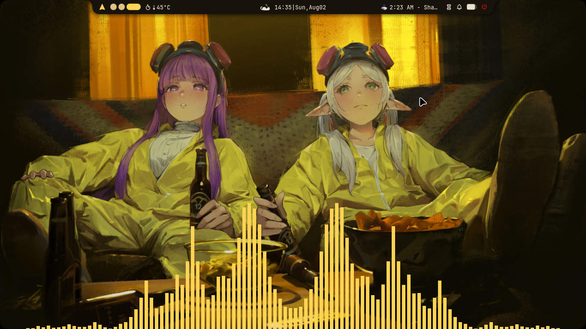
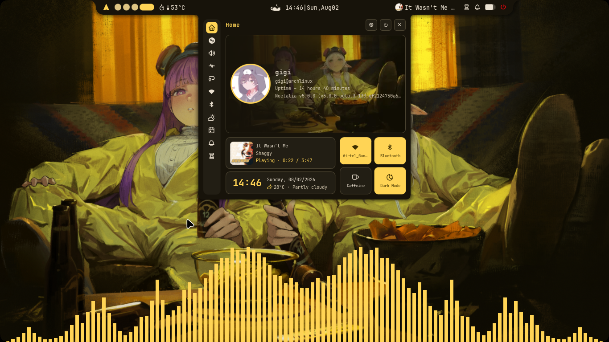
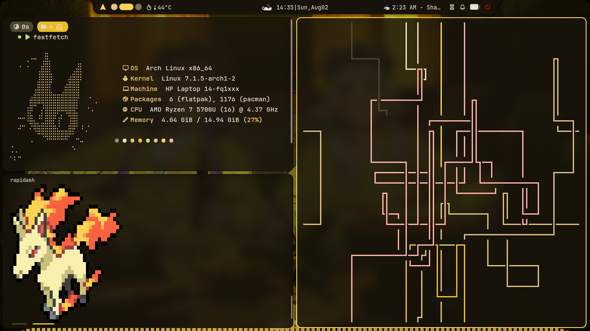
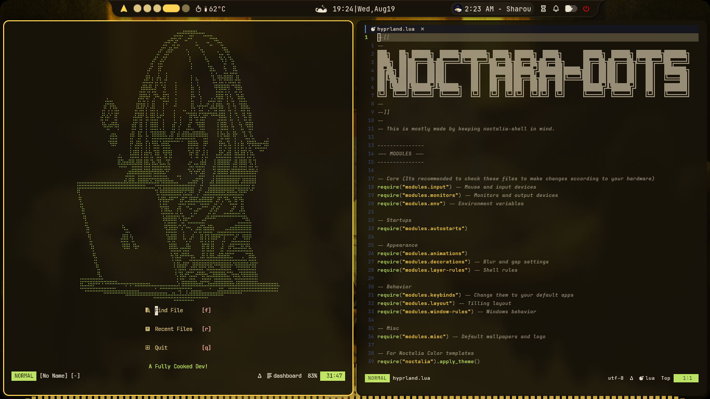
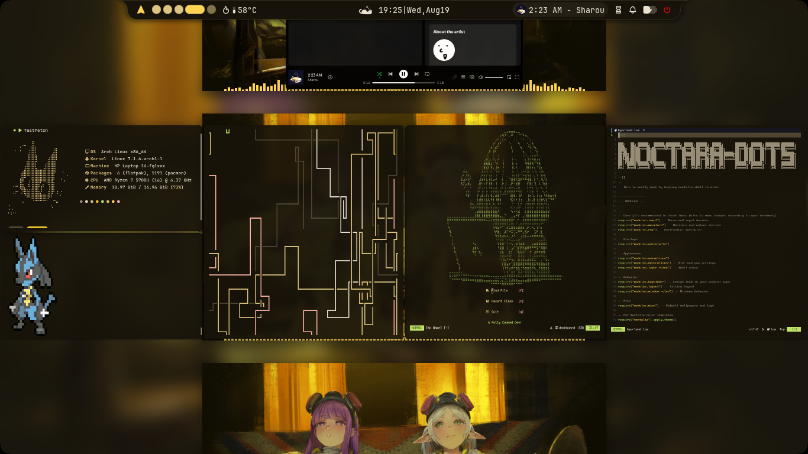
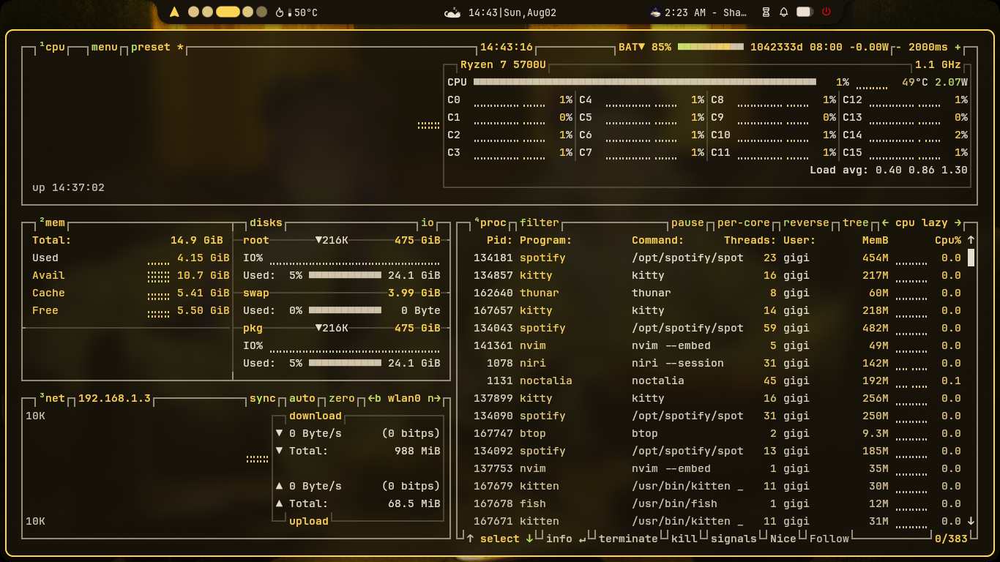

<div align="center">

# 🌙 Noctara-dots

<sub><i>Because your desktop deserves better life choices.</i></sub>

<br />



<br />


</div>

---

## 📌 Table of Contents

- [Overview](#-overview)
- [Why Noctara-dots?](#-why-noctara-dots)
- [Showcase](#-showcase)
- [Features](#-features)
- [Software Used](#-software-used)
- [Documentation](#-documentation)
- [Quick Start](#-quick-start)
- [Keybindings](#%EF%B8%8F-keybindings)
- [Default Applications](#-default-applications)
- [Wallpapers](#-wallpapers)
- [Repository Structure](#-repository-structure)
- [Credits](#%EF%B8%8F-credits)

---

## ✨ Overview

**Noctara-dots** is a modular, ready-to-use desktop rice for **Arch Linux**, built around **Noctalia v5** for both **Niri** and **Hyprland** Wayland compositors.

Instead of spending days manually tweaking individual configuration files, themes, animations, and keybindings, Noctara-dots delivers an out-of-the-box desktop experience that looks great and stays easy to customize.

> 📖 **Looking for full setup guides?**
> Check out the official [Noctara Documentation Site](https://deadduck-09.github.io/Noctara-Docs/) for full installation, customization, and troubleshooting steps.

---

## ❓ Why Noctara-dots?

**Noctalia v5** provides a powerful shell, but configuring a complete desktop environment still requires configuring compositors, matching terminal themes, tweaking editors, setting up media control, and organizing keybindings.

Noctara-dots bridges this gap by unifying these components into a consistent, modular framework:

- 🧩 **Modular Architecture:** Tweak or swap individual applications without breaking your setup.
- 🎨 **Unified Design:** Seamless colors, fonts, and aesthetics across shell, terminal, and editors.
- ⚡ **Zero-Hassle Setup:** One-command installer configures packages, backup management, and configs automatically.

---

## 🖼 Showcase

<details>
<summary><strong>🌙 Desktop</strong></summary>

<br>



</details>

<details>
<summary><strong>💻 Terminal Setup</strong></summary>

<br>



</details>

<details>
<summary><strong>📝 Neovim Setup</strong></summary>

<br>



</details>

<details>
<summary><strong>🪟 Niri Overview</strong></summary>

<br>



</details>

<details>
<summary><strong>📊 Resource Monitor</strong></summary>

<br>



</details>

---

## ✨ Features

- 🚀 **Automated Installer:** Setup script handles packages, dependencies, and shell selection.
- 📦 **Smart Backups:** Automatic backup and restore support for existing configuration files.
- 🧩 **Fully Modular:** Clean, organized directory structure for easy customization.
- 🪟 **Compositor Support:** Out-of-the-box profiles for **Niri**, **Hyprland** and **Mango**.
- 💻 **Complete Workflow:** Integrated terminal apps, media tools, and resource monitoring.

---

## 🛠 Software Used

| Component          | Software        |
| :----------------- | :-------------- |
| **Desktop Shell**  | Noctalia v5     |
| **Window Manager** | Niri / Hyprland |
| **Terminal**       | Kitty           |
| **Shell**          | Fish            |
| **Prompt**         | Starship        |
| **Editor**         | Neovim          |
| **File Manager**   | Yazi            |
| **Music**          | MPD + rmpc      |
| **Media Player**   | MPV             |
| **System Info**    | Fastfetch       |

---

## 📚 Documentation

For complete, detailed instructions on tweaking, extending, and troubleshooting Noctara-dots, check out the documentation files:

> 💡 **Detailed Guides:**
>
> - [📖 **Full Wiki & User Guide**](https://deadduck-09.github.io/Noctara-Docs/) _(Overview of all detailed docs)_
> - [⚙️ **Window Manager Settings**](https://deadduck-09.github.io/Noctara-Docs/configuration/window-managers/niri.html) _(Changing keybinds, env variables and monitor settings)_
> - [🪟 **Customization**](https://deadduck-09.github.io/Noctara-Docs/customization/wallpapers.html) _(Changing Icons and wallpapers)_

---

## 🚀 Quick Start

### Requirements

- An **Arch Linux** installation (or Arch-based distro)
- Active internet connection
- **Niri** or **Hyprland** installed

---

### Installation

## Automatic Installation (Recommended)

Clone the repository:

```bash
git clone https://github.com/deadduck-09/Noctara-Dots.git
cd Noctara-Dots
```

Run the installer:

```bash
./install.sh
```

When the installation is complete:

1. Log out:

```text
Ctrl+Alt+Del
```

2. Log back in.
3. Enjoy your new desktop.
4. Take a look through the configs and make it yours.

---

## Manual Installation

Prefer doing everything yourself?

Simply copy whichever configuration folders you want into your `~/.config` directory.

Example:

```bash
cp -r configs/niri ~/.config/
cp -r configs/noctalia ~/.config/
cp -r configs/kitty ~/.config/
```

Copy the wallpapers:

```bash
mkdir -p ~/Pictures/Wallpapers
cp wallpapers/* ~/Pictures/Wallpapers/
```

You can mix and match components however you'd like.

---

# ⌨️ Keybindings

<details>

<summary><strong>View Default Keybindings</strong></summary>

### 🌙 Noctalia

| Shortcut    | Action               |
| ----------- | -------------------- |
| Super + L   | Lock Screen          |
| Super + ,   | Wallpaper Picker     |
| Super + .   | Emoji Picker         |
| Super + V   | Clipboard History    |
| Super + D   | Control Center       |
| Alt + Space | Application Launcher |

---

### 🚀 Applications

| Shortcut  | Action       |
| --------- | ------------ |
| Super + T | Kitty        |
| Super + B | Browser      |
| Super + E | File Manager |
| Super + M | Music        |
| Super + O | Notes        |
| Super + C | Code Editor  |

</details>

---

# 📌 Default Applications

<details>

<summary><strong>View Default Applications</strong></summary>

| Category        | Application |
| --------------- | ----------- |
| 🌐 Browser      | Helium      |
| 💻 Terminal     | Kitty       |
| 📝 Code Editor  | VSCodium    |
| 📖 Notes        | Obsidian    |
| 📂 File Manager | Thunar      |
| 🎵 Music        | Spotify     |

All shortcuts are configured around these applications by default, but changing them only requires editing a few lines thanks to the modular configuration.

</details>

---

# 🌄 Wallpapers

For my complete wallpaper collection, visit:

➡️ **[FireWalls](https://github.com/deadduck-09/FireWalls)**

---

# 📂 Repository Structure

```text
.
├── assets
│   ├── desktop-cc.png
│   ├── desktop.png
│   ├── niri-overview.png
│   ├── nvim-setup.png
│   ├── resources.png
│   └── terminal-setup.png
├── configs
│   ├── btop
│   ├── cava
│   ├── fastfetch
│   ├── fish
│   ├── hypr
│   ├── kitty
│   ├── mango
│   ├── mpd
│   ├── mpv
│   ├── niri
│   ├── noctalia
│   ├── nvim
│   ├── rmpc
│   ├── starship.toml
│   └── yazi
├── home
├── install.sh
├── LICENSE
├── local
│   ├── share
│   └── state
├── Pictures
│   ├── Pfps-and-logos
│   └── Wallpapers
└── README.md
```

---

# ❤️ Credits

A huge thank you to the developers behind these amazing open-source projects.

- **[Niri](https://github.com/YaLTeR/niri)**
- **[Noctalia](https://github.com/NoctaliaDev/noctalia-shell)**
- **[Kitty](https://sw.kovidgoyal.net/kitty/)**
- **[Neovim](https://github.com/neovim/neovim)**
- **[MPD](https://github.com/MusicPlayerDaemon/MPD)**
- **[rmpc](https://github.com/mierak/rmpc)**
- **[Fastfetch](https://github.com/fastfetch-cli/fastfetch)**
- **[Yazi](https://github.com/sxyazi/yazi)**
- **[MPV](https://github.com/mpv-player/mpv)**

Noctara-dots wouldn't exist without these amazing projects

---

# ⭐ Support

If you enjoy Noctara-dots:

- ⭐ Star the repository
- 🍴 Fork it
- 🛠 Customize it
- 💜 Share it with others

Every contribution, issue report, suggestion, or star helps make the project even better.

---

> _"My desktop may look minimal, but the hours spent configuring it definitely weren't."_ 🌙
